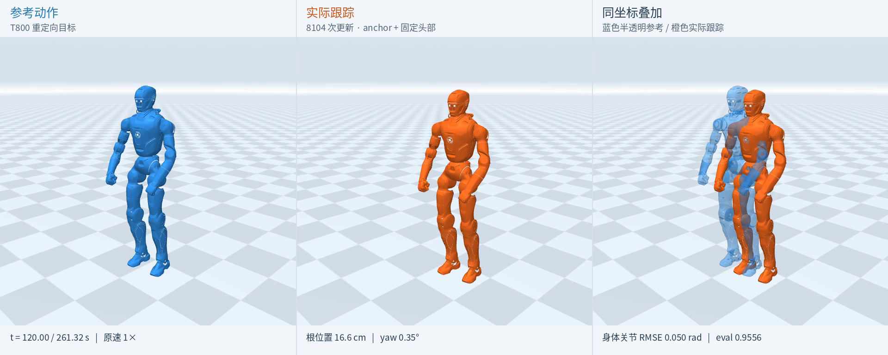

# SuperMimic on EngineAI T800

将 [CuboiLeo/SuperMimic-Reproduced](https://github.com/CuboiLeo/SuperMimic-Reproduced) 适配到众擎 **T800** 的仿真研究项目：保留可微世界模型与想象轨迹中的策略优化，完成机器人适配、编译兼容修正、参考动作检查、长动作训练及独立评估。

**当前结果（2026-10-29）：** 单张 RTX 5070 Ti 16 GB，完整 `walk1_subject1` 动作，**8104 次策略更新**；开启 **9 维 anchor-relative pose** 并固定头部 PD 目标后，完成 **261.32 秒**评估，normalized return **0.9556**，平均根位置误差 **13.74 cm**，平均绝对 yaw 误差 **1.01°**。

这是**单条训练动作上的仿真结果**，尚未验证未见动作泛化或真机部署。



蓝色为参考，橙色为实际状态。右侧保留真实世界坐标偏差，没有为了重合而平移或旋转实际轨迹。

[完整视频与检查点](https://github.com/EthanCodesss/SuperMimic-T800/releases/tag/v0.1.0) · [原始评估数据](docs/results/anchor-head-final.json) · [实验说明](docs/results/README.md) · [上游 README](README.upstream.md)

## 结果与边界

两组使用相同的完整参考、T800 PD 参数、动作缩放、奖励权重、训练规模和 8104 次更新预算；均包含 FK 编译修正。表中为 IEEE FP32、无观测/动作噪声和域随机化、从动作首帧开始的独立评估。

| 指标 | 无 anchor，头部由策略控制 | Anchor + 固定头部 |
|---|---:|---:|
| 完成完整 261.32 秒动作 | 是 | 是 |
| Evaluation normalized return | 0.6363 | **0.9556** |
| 平均根位置误差 | 9.6147 m | **0.1374 m** |
| 平均绝对 yaw 误差 | 83.25° | **1.01°** |
| 全部 25 关节 RMSE | 0.2421 rad | **0.0818 rad** |
| 身体 23 关节 RMSE，不含头部 | **0.0665 rad** | 0.0850 rad |
| 头部两关节 RMSE | 0.8258 rad | **0.0200 rad** |

- 新组另做五次不同种子的**重置扰动**评估，全部完成，return 为 **0.9541–0.9553**；这不是五个独立训练种子，也不是外力推搡测试。
- 两项干预同时开启，不能将收益单独归因于 anchor 或固定头部。相同 seed 也不意味着不同输入维度的网络具有相同初始权重。
- 全局跟踪和头部稳定性显著改善，但身体 23 关节 RMSE 略高于基线；没有宣称所有指标都改善。
- 平均 13.7 cm 的位置误差仍然存在；高 return 不等于精准落脚、接触任务或严格的世界坐标轨迹跟随。
- 上游 benchmark 评估流程的 T800 适配版本得到 **0.9559**（默认 TF32），与上表 IEEE 物理评估分开记录。机器人、重定向参考和任务不同，不能将它当作对 G1 e1c 基准的直接超越。

## 实现包含什么

| 部分 | 当前采用的实现 |
|---|---|
| 参考动作 | 原始 LAFAN1 → 固定版本众擎 GMR → T800，完整连续 IK 后重采样至 50 Hz，13066 帧。训练前选择右臂 IK 初始姿态，避免长期贴限位。 |
| 机器人与环境 | T800 MJCF，25 关节，按名字映射；T800 的 Kp、Kd、力矩限幅、armature 和默认姿态；物理 200 Hz，控制 50 Hz。 |
| 观测与目标 | 最近 10 帧本体观测（810 维），未来 10 帧参考（600 维），另加 9 维 anchor 相对位置/方向，共 609 维目标。 |
| 策略 | 参考编码器 → 32 维潜变量 → 解码器；保留 25 维输出格式，实际启用 23 个身体输出。 |
| 动作与 PD | `q_target = q_default + action_scale * raw_action`，`action_scale = 0.25 * effort_limit / Kp`，使用 T800 参数；原始动作不强制限制在 `[-1, 1]`。 |
| 回放与世界模型 | 保存实际状态、干净/执行动作及随机化参数；8 步世界模型训练。 |
| 策略优化 | 在世界模型中展开 32 步想象轨迹，以奖励和 critic 目标反向传播；保持原训练 batch、网络及学习率规划。 |
| 评估与可视化 | 独立物理回放、完整动作 return、关节/根位置/yaw 误差、奖励分项、重置扰动；同步展示参考和保存的实际状态。 |

Anchor 选用 **`LINK_WAIST_YAW`**，物理根为 `LINK_BASE`；14 个跟踪刚体按 G1 的解剖位置对应，肘部选屈伸轴对应的 `LINK_ELBOW_PITCH_*`。头部不参加刚体跟踪奖励；两个头部动作、执行噪声和回放动作一致屏蔽，PD 目标保持默认角度，**保留实际头部动力学和状态**。

对应入口：[T800 参数](src/supermimic/robots/t800.py)、[任务映射](scripts/t800_task_adapter.py)、[动作尺度](scripts/t800_action_scaling.py)、[组合配置](scripts/t800_anchor_head_profile.py)、[固定头部](scripts/t800_fixed_head.py)。通用 `sm-train` 并不会自动启用这些实验适配，复现请使用下面的专用入口。

## 关键修正：可微 FK 的编译分支

本地 PyTorch 2.11.0 环境中，下面的整数与 MuJoCo pybind 枚举比较在 eager 模式成立，却在 `torch.compile` 路径被错误处理，导致 hinge FK 分支及其梯度丢失：

```python
# 修正前
l.joint_type == mujoco.mjtJoint.mjJNT_HINGE
# 修正后
l.joint_type == int(mujoco.mjtJoint.mjJNT_HINGE)
```

[scripts/fk_compile_compat.py](scripts/fk_compile_compat.py) 在进程中安装修正，保留上游源码快照，并在检查点记录哈希。G1 对照中，编译/eager 奖励最大差由约 0.023 降至 1.5e-8，动作梯度余弦相似度由约 0.10 恢复至接近 1。**世界模型状态预测误差较小，不能排除解析奖励及其梯度存在问题。**

显存优化仅对策略前向进行激活重计算：4096 环境、actor batch 4096、32 步想象和原网络规模保留；不是缩小任务配置。IEEE FP32 与上游 CUDA 13/TF32 软件栈存在明确差异。

## 安装

已验证平台：Linux x86_64、Python 3.12、RTX 5070 Ti 16 GB、驱动 570.211.01；PyTorch **2.11.0+cu128**、Warp **1.18.0+cu12**、MuJoCo/MuJoCo Warp **3.16.0**。请先安装 Conda，并确认 `nvidia-smi` 正常。

```bash
git clone https://github.com/EthanCodesss/SuperMimic-T800.git
cd SuperMimic-T800
bash scripts/bootstrap.sh
conda activate supermimic
python scripts/fetch_sources.py --verify-only
python scripts/check_gpu.py
```

安装器恢复固定提交的上游、mjlab 和众擎 GMR 快照，再检查哈希；普通依赖默认从阿里云镜像安装，可通过 `SUPERMIMIC_PYPI_INDEX=https://pypi.org/simple` 覆盖。发布用依赖锁将原环境导出的本机 `packaging` 文件路径替换为相同版本 `packaging==26.3`，原始锁保留供审计。详见 [环境与来源](configs/README.md)。

完整训练在本机约 **4 小时**，实际耗时和显存受设备、编译缓存及桌面程序影响。安装、编译缓存、检查点和数据另需磁盘空间。

## 准备参考动作

动作文件不随代码分发。先从 [LAFAN1 官方项目](https://github.com/ubisoft/ubisoft-laforge-animation-dataset) 按其许可证取得数据，将完整 `walk1_subject1.bvh` 放到 `data/raw/lafan1/`。本实验使用 7840 个原始帧、30 Hz；下载包和原文件哈希见 [数据复现说明](docs/DATA.md)。

```bash
mkdir -p reports/task_alignment_study

# 生成未调整 IK 初始姿态的完整参考，供原始质量对照使用。
python scripts/prepare_t800.py \
  --bvh data/raw/lafan1/walk1_subject1.bvh --start 0 --frames 7840 \
  --out data/npz/t800_walk1_full/walk1_subject1.npz

# 使用训练前选定的初始姿态，完整连续重定向；没有逐帧重启或平滑。
python scripts/prepare_t800_continuous_reference.py \
  --out data/npz/t800_walk1_selected_seed/walk1_subject1.npz \
  --reference-native-csv data/npz/t800_walk1_full/walk1_subject1.csv \
  --root-seed reference --initial-seed docs/results/reference-ik-seed.json \
  --report reports/task_alignment_study/continuous-ik-selected-seed-comparison.json

python scripts/verify_release_reference.py \
  data/npz/t800_walk1_selected_seed/walk1_subject1.npz
```

脚本保护已有输出文件，请使用新目录重做实验。数据验证比较实际数组和帧数；如果版本或求解器变化导致结果不同，应先检查原因，再将其作为新的实验输入。

## 训练

先检查配置，不启动训练：

```bash
python scripts/train_t800_anchor_head.py --robot t800 \
  --motion-dir data/npz/t800_walk1_selected_seed --clips walk1_subject1 \
  --run-name t800_anchor_head_repro --anchor-obs \
  --matmul-precision ieee --recompute-mode policy --config-only
```

使用相同训练配方，从 seed 0 新建策略，运行到 8104 次更新：

```bash
python scripts/train_t800_anchor_head.py --robot t800 \
  --motion-dir data/npz/t800_walk1_selected_seed --clips walk1_subject1 \
  --run-name t800_anchor_head_repro --anchor-obs \
  --stop-after-updates 8104 --checkpoint-updates 2000 4052 8104 \
  --save-initial-checkpoint --matmul-precision ieee --recompute-mode policy
```

配置和逐次更新记录保存到 `reports/microbatch/<run-name>/`，检查点位于 `logs/<run-name>/`。停止预算不会缩短原始 320000 控制步的学习率规划。可先用新 run-name 和 `--stop-after-updates 3` 验证完整 batch 能运行。

无 anchor 基线使用 `scripts/train_t800_fk_compat.py`，省略 `--anchor-obs`，其余参数相同。恢复训练可增加 `--resume <checkpoint>`；`--stop-after-updates` 表示**额外**更新次数。恢复会重新填充回放，不恢复 RNG/仿真状态，不保证与不中断训练逐步一致。

仓库保留历史诊断脚本；早期 `train_memory.py`、`run_training_stage.py` 没有完整的当前修正，不是推荐的最终训练入口。`docs/results/anchor-head-protocol.json` 是原实验不可变记录，包含原机路径及本地预检查产物，不能直接用作另一台机器的新运行协议。

## 下载并评估已训练模型

从 [v0.1.0 Release](https://github.com/EthanCodesss/SuperMimic-T800/releases/tag/v0.1.0) 下载原始检查点，核对 SHA256。若安装了 GitHub CLI：

```bash
gh release download v0.1.0 --repo EthanCodesss/SuperMimic-T800 \
  --pattern 't800_anchor_head_8104.pt' --pattern 'SHA256SUMS' --dir artifacts
(cd artifacts && sha256sum --ignore-missing -c SHA256SUMS)

# 原始检查点保留不动，只生成适配当前 checkout 路径的新副本。
python scripts/relocate_t800_checkpoint.py \
  --input artifacts/t800_anchor_head_8104.pt \
  --output artifacts/t800_anchor_head_8104.local.pt

python scripts/evaluate_t800_anchor_head.py --robot t800 \
  --checkpoint artifacts/t800_anchor_head_8104.local.pt \
  --motion data/npz/t800_walk1_selected_seed/walk1_subject1.npz \
  --out reports/reproduction/final.json --wm-horizon 32
```

路径迁移工具校验执行配置和源码锁，并在保存后验证世界模型、策略、critic 及其优化器内容哈希均未变化。直接评估新训练的检查点不需要这一步。

对齐上游的 benchmark 计算流程：

```bash
python scripts/evaluate_t800_anchor_head_benchmark.py \
  --checkpoint artifacts/t800_anchor_head_8104.local.pt \
  --motion data/npz/t800_walk1_selected_seed/walk1_subject1.npz \
  --out reports/reproduction/benchmark.json
```

**指标口径：** `normalized_return = mean(step_reward) / 0.1`；提前终止时，另看 `normalized_full_clip_return = sum(step_reward) / (reference_frames * 0.1)`，缺失尾段视为零。本实验最终完整动作两者相等。训练日志是在随机参考相位和随机化环境下累积的 episode return，与此完整动作 evaluation return 不同。yaw 指标按腰部 anchor 朝向计算；根位置为 `LINK_BASE` 的世界坐标位置。局部刚体姿态奖励会对参考做水平位置/yaw 对齐，因此局部姿态好不代表全局轨迹重合。

## 可视化

Release 提供完整视频和 `t800_tracking_player.zip`；解压后用浏览器打开 `index.html` 即可逐帧、变速和点击误差曲线跳转，不需要 GPU。

从新的评估轨迹生成同类播放器：

```bash
MUJOCO_GL=egl python scripts/render_t800_tracking_comparison.py \
  --trajectory reports/reproduction/final.trajectory.npz \
  --evaluation reports/reproduction/final.json \
  --out reports/reproduction/visualization
```

渲染使用评估保存的真实状态和对应参考帧，25 FPS、原速；只做运动学渲染，不重新运行策略。当前渲染脚本的页面说明面向本次 8104 更新组合实验；用于其他任务时应同步修改说明。

## 检查与项目结构

```bash
python scripts/fetch_sources.py --verify-only
SUPERMIMIC_ROBOT=t800 python -m pytest -q \
  tests/test_robot_adapter.py tests/test_checkpoint_relocation.py
```

```text
src/supermimic/       算法、环境及 T800 本体适配，受源码锁校验
scripts/             当前训练/评估入口、进程内适配、数据与诊断工具
optimizations/       保留原规模的激活重计算
configs/             版本、源码哈希及参数记录
assets/robots/t800/  机器人来源声明
vendor/              固定版本外部来源；大型快照由安装器恢复
docs/results/        已完成实验的评估、配置、协议及审计摘要
docs/history/        早期诊断记录，不代表当前最佳结果
logs/, reports/      本地运行生成，默认不提交
data/, artifacts/    本地数据和下载的检查点，默认不提交
```

## 许可证与致谢

代码保留上游 [MIT License](LICENSE) 及作者声明。第三方机器人、众擎参考配置和数据沿用各自许可证，见 [THIRD_PARTY_NOTICES.md](THIRD_PARTY_NOTICES.md)。**本仓库的代码许可证不覆盖 LAFAN1 及其重定向动作数据**；原始 BVH、参考 CSV/NPZ、包含逐帧参考的回放文件不随代码或 Release 分发。

感谢 [CuboiLeo/SuperMimic-Reproduced](https://github.com/CuboiLeo/SuperMimic-Reproduced)、[mjlab](https://github.com/mujocolab/mjlab)、[众擎 GMR](https://github.com/engineai-robotics/GMR)、[众擎 RL Lab](https://github.com/engineai-robotics/engineai_rl_lab) 和 [LAFAN1](https://github.com/ubisoft/ubisoft-laforge-animation-dataset)。本项目为 T800 的独立适配与实验记录。
